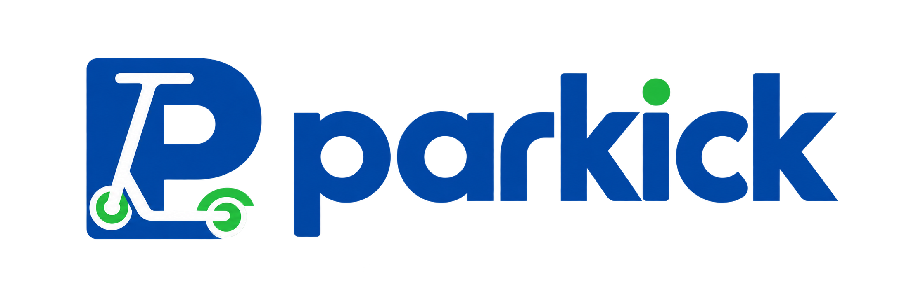
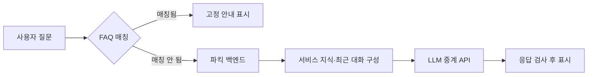
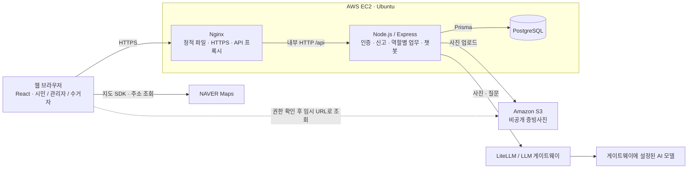

<div align="center">
  
  <h1>Parkick | 파킥</h1>
  <p><strong>공유 전동킥보드 부적정 주차 신고 및 AWS Bedrock 기반 AI 분석·관리 지원 플랫폼</strong></p>
  <p>시민 신고에서 관리자 검토와 현장 수거까지 이어지는 반응형 웹 서비스</p>
  <p><a href="https://15.165.235.154/">서비스 접속</a> · <a href="#주요-기능">주요 기능</a> · <a href="#시스템-아키텍처">아키텍처</a> · <a href="#로컬-실행">실행 방법</a></p>
</div>

## 프로젝트 소개

Parkick은 보도·점자블록·출입구 등에 부적절하게 주차된 공유 전동킥보드와 자전거를 시민이 신고하고, 관리자가 신고를 검토하며 수거 담당자가 현장을 확인할 수 있도록 개발한 웹 플랫폼입니다. **Parking + Kickboard**라는 이름에 공유 이동수단의 편리함과 안전한 보행 환경을 함께 지키겠다는 목표를 담았습니다.

시민은 회원가입 없이 기기 정보·사진·위치를 입력해 신고합니다. 관리자는 신고 목록과 지도에서 현황을 확인하고, 수거 담당자는 현재 위치에서 가까운 대상을 찾아 수거 결과나 기기 미발견 사실을 기록합니다. AI는 촬영 구도 안내, 사진 속 대상 확인, 서비스 이용 질문에 대한 답변을 지원합니다.

> 현재 개발용 서비스이며, 실제 지자체에 신고를 자동 전달하지 않습니다. 사진 AI는 주차 위반이나 법적 책임을 판정하는 기능이 아닙니다.

## 주요 기능

### 1. 회원가입 없는 5단계 신고

| 단계 | 입력 및 동작 |
| --- | --- |
| 기기 정보 | QR 스캔 또는 수동 입력으로 운영업체와 기기번호 확인 |
| 현장 사진 | 사진 1~2장 첨부, 미리보기, 사진 사전 검사 |
| 위치 확인 | GPS·지도 또는 좌표 직접 입력으로 신고 위치 확인 |
| 신고 유형 | 유형을 하나 이상 선택하고 필요한 경우 추가 설명 입력 |
| 연락처 및 제출 | 연락처 선택 입력·동의, 신고 요약 확인 후 제출 |

- 운영업체와 기기번호는 필수이며, QR을 읽지 못하면 직접 입력할 수 있습니다.
- 주소·위치 설명과 연락처는 선택 사항입니다. 좌표와 실제 위치 확인은 필요합니다.
- ‘기타’ 유형의 추가 설명은 선택이며 최대 500자입니다.
- 현재 신고 화면에는 별도의 신고문 작성·AI 초안 생성 단계가 없습니다. 서버가 신고 유형을 바탕으로 요약을 구성합니다.
- 접수 결과에는 접수번호가 표시됩니다. 결과가 불명확한 재시도는 동일한 제출 식별자를 이용해 중복 접수를 방지합니다.

### 2. 사진 최적화와 AI 대상 확인

현장 사진은 **1~2장, 원본 기준 장당 최대 10MiB**까지 첨부할 수 있으며 JPEG·PNG·WebP 정지 사진을 지원합니다.

- 브라우저에서 사진 방향을 반영하고 긴 변을 최대 2,560px로 조정해 업로드 용량을 줄입니다.
- 서버에서 형식·손상·해상도를 검사하고, 방향 보정 및 메타데이터 제거 후 JPEG로 저장합니다.
- 사진 AI가 켜진 환경에서는 실제 킥보드나 자전거가 사진의 주 대상인지 확인합니다.
- 관계없는 사진이 한 장이라도 있거나 모든 사진이 판단 불가이면 진행을 막고 다시 첨부하도록 안내합니다.
- 사진 단계의 사전 검사뿐 아니라 신고 제출 시에도 서버에서 검사 흐름을 적용합니다.
- 촬영 중에는 축소한 카메라 화면을 이용해 기기 크기·중앙 배치·전체 구도를 안내합니다.

촬영 안내는 첨부 사진의 검사 통과를 보장하지 않습니다. 공유 PM 여부를 완벽하게 식별하는 기능도 아니며, 모델 판단에는 오류가 있을 수 있습니다. 사진 AI를 비활성화한 개발 환경에서는 파일 형식 검사만 수행합니다.

### 3. QR·지도 기반 정보 입력

- 카메라 또는 QR 이미지에서 운영업체와 기기 정보를 읽습니다.
- 지쿠·빔·카카오 T 바이크·스윙·알파카·일레클 등에 대한 파서를 구성하되, 확인된 형식별로 처리합니다. 모든 QR 형식을 지원한다는 의미는 아닙니다.
- QR 주소를 자동으로 열지 않으며, 인식되지 않는 정보는 사용자가 직접 입력합니다.
- NAVER Maps로 신고 위치와 지도 핀을 표시하고 주소 조회를 지원합니다.
- GPS·지도 오류 시 좌표를 직접 입력할 수 있습니다. 주소만 입력해서 좌표가 설정되는 구조는 아닙니다.

### 4. 전화번호 기반 처리결과 조회

신고할 때 휴대전화 번호를 남긴 시민은 **처리결과 조회**에서 같은 번호로 신고 내역과 공개 처리 이력을 확인할 수 있습니다.

- 연락처는 선택 사항이며, 입력 시 수집·이용 동의가 필요합니다.
- 현재 010으로 시작하는 11자리 번호를 지원합니다.
- 번호를 남기지 않은 신고는 전화번호로 조회할 수 없습니다.
- 전화번호 일치는 검색 조건이며 별도의 SMS 본인인증은 구현돼 있지 않습니다.
- 공개 처리 메모와 관리자 내부 메모를 구분합니다.

### 5. 관리자와 수거자 역할 분리

공통 운영자 로그인 후 **계정 역할에 따라 서로 다른 화면과 API**를 사용합니다.

| 구분 | 관리자 | 수거 담당자 |
| --- | --- | --- |
| 역할 | `PLATFORM_ADMIN`, `TENANT_ADMIN` | `COLLECTOR` |
| 화면 | `/admin` | `/collect` |
| 주요 기능 | 현황 집계, 신고 목록·상세·지도, 반려·완료 처리, 현장 기록 검토 | 가까운 수거 대상, 현장 상세·사진, 길찾기, 수거 완료·기기 미발견 보고 |
| 접근 범위 | 플랫폼 전체 또는 소속 범위 | 계정 소속 범위 |

- 프론트엔드 경로 보호와 백엔드 권한 검사를 함께 적용합니다.
- 수거자 목록의 거리는 현재 위치로부터의 **직선거리**이며 예상 이동 시간이나 도로 거리가 아닙니다.
- 도보·차량 길찾기는 NAVER 지도 앱 연결을 사용합니다.
- 기기를 찾지 못한 현장 기록은 관리자 검토로 이어지며, 수거자의 미발견 보고 자체가 최종 반려를 뜻하지 않습니다.
- 과거 `처리중`·`견인 완료` 이력은 표시할 수 있지만 현재 화면의 신규 완료 동작은 수거 완료 중심입니다.

### 6. 신고 지도와 밀집 구역

관리자는 지도에서 신고 위치와 분포를 확인할 수 있습니다. 가까운 신고들을 150m 연결 기준으로 묶고 **3~4건은 관심 구역, 5건 이상은 집중 구역**으로 표시합니다. 이는 신고 밀집도를 시각화하는 규칙이며 AI가 법적 위험도를 판정하는 기능은 아닙니다.

### 7. 파킥 도우미 — 정보 안내 챗봇

신고 방법, 사진 조건, QR·위치 입력, 처리 절차와 조회 방법을 화면 안에서 질문할 수 있습니다.



- 추천 질문 5개와 직접 질문 입력을 제공합니다.
- FAQ에 매칭되는 질문은 외부 모델 호출 없이 답합니다.
- 자유 질문에는 서비스 안내·FAQ·최근 완료된 대화 최대 3쌍을 요청에 포함합니다. 대화 이력은 총 3,600자로 제한합니다.
- 모델을 별도로 학습시키는 방식이 아니라, 검증한 서비스 자료를 프롬프트에 포함하는 구조입니다.
- 로딩·중복 전송 방지·재시도·대화 초기화·요청 취소를 지원합니다.
- 대화는 브라우저 메모리로 관리하며 별도의 영구 대화 DB를 추가하지 않았습니다.
- 챗봇은 개인 신고를 조회하거나 신고 접수·전달·상태 변경을 실행하지 않습니다.
- 홈 FAQ는 전용 데이터로 분리해 챗봇 지식 추가가 홈 질문 목록을 바꾸지 않도록 구성했습니다.

현재 챗봇은 `GatewayChatProvider`로 중계 API를 호출합니다. 사진 AI의 LiteLLM → AWS Bedrock 연계는 배포 문서에 기록돼 있으며, 챗봇의 모델 별칭과 정확한 실제 모델·버전은 게이트웨이 설정에 따릅니다.

## 반응형 UI

PC·태블릿·모바일 브라우저에서 동일한 웹 주소로 이용할 수 있도록 구성했습니다. 신고 단계와 운영자 화면에 모바일 레이아웃을 적용하고, 챗봇은 PC 플로팅 패널과 680px 이하 화면의 확장형 패널로 구분합니다. 메시지 내부 스크롤, 터치 조작, 하단 안전 영역과 키보드 높이 변화를 고려했습니다.

카메라·GPS는 브라우저 권한과 보안 컨텍스트가 필요합니다. 스마트폰에서 다른 기기의 일반 HTTP 개발 주소로 접속할 경우 기능이 제한될 수 있으므로 HTTPS 환경을 사용해야 합니다.

## 시스템 아키텍처



- React/Vite 빌드 파일은 Nginx가 제공하고 브라우저에서 실행합니다.
- API와 PostgreSQL은 배포 문서 기준 동일 EC2에 있으며, API는 systemd로 관리합니다.
- DB에는 신고·계정·세션·처리 이력과 사진 `objectKey`를 저장합니다. 사진 파일 자체는 S3에 저장합니다.
- 사진 조회는 백엔드의 접근 권한 확인 후 짧은 유효기간의 S3 서명 URL로 연결합니다.
- API 키와 AWS 인증정보는 프론트엔드에 배치하지 않습니다.

## 기술 스택

| 영역 | 기술 |
| --- | --- |
| Frontend | React 19, TypeScript, Vite, React Router, Tailwind CSS |
| Backend | Node.js, Express 5, TypeScript, Zod |
| Database | PostgreSQL, Prisma 6 |
| Storage | Amazon S3, AWS SDK, Sharp |
| AI | LiteLLM / LLM 게이트웨이, AWS Bedrock 연동 경로 |
| Map / QR | NAVER Maps JavaScript API, qr-scanner |
| Test | Node.js Test Runner, Supertest, Playwright |
| Deployment | Ubuntu EC2, Nginx, systemd |

## 프로젝트 구조

```text
Parkick/
├── frontend/
│   └── src/
│       ├── api/                  # 백엔드 API 호출
│       ├── components/           # 공통·관리자·수거자 레이아웃
│       ├── features/             # 신고, 사진, 지도, QR, 챗봇 등
│       └── pages/                # 시민·관리자·수거자 화면
├── backend/
│   ├── prisma/                   # DB 스키마·마이그레이션·개발 seed
│   ├── scripts/                  # 로컬 실행·설정·점검 도구
│   ├── src/
│   │   ├── routes/               # API 경로와 요청 검증
│   │   ├── controllers/          # HTTP 요청·응답
│   │   ├── services/             # 업무·AI·저장 서비스
│   │   └── repositories/         # DB 접근
│   └── test/                     # 단위·API·DB 통합 테스트
├── shared/                       # 업체 정보·챗봇 FAQ·서비스 지식
├── tests/                        # Playwright 시나리오
├── deploy/                       # 운영 설정과 배포 문서
├── docs/                         # 기능·적용 안내
├── asset/                        # 브랜드 이미지
└── page/                         # 화면 관련 자료
```

## 로컬 실행

### 준비

- Node.js **22.18 이상**과 npm
- 신고·조회·운영자 기능을 확인할 때 PostgreSQL
- 지도·외부 AI·S3를 사용할 때 해당 서비스의 설정과 권한

```bash
git clone https://github.com/yanggun2/Parkick.git
cd Parkick
npm ci --include=dev
```

설치 과정에서 Prisma Client를 생성합니다. 실제 `.env`와 인증정보는 저장소에 포함하지 않습니다. `.env.example`, `frontend/.env.example`, `backend/.env.example`을 참고해 필요한 값을 각 실행 환경에 설정하세요. 기존 설정을 덮어쓰지 마세요.

### 일반 개발 서버

프로젝트 루트에서 별도 터미널로 실행합니다.

```bash
# 프론트엔드
npm run dev:frontend
```

```bash
# 백엔드
npm run dev:backend
```

프론트엔드는 기본 `http://127.0.0.1:5173`, 백엔드는 기본 `http://127.0.0.1:4000`을 사용합니다. Windows PowerShell에서는 `npm` 대신 `npm.cmd`를 사용할 수 있습니다.

### 로컬 DB 준비

PostgreSQL 실행 파일을 준비한 뒤 프로젝트 전용 개발 DB를 초기화할 수 있습니다. 자동으로 찾지 못하면 `PARKICK_PG_BIN`에 PostgreSQL의 `bin` 경로를 지정하세요.

```bash
npm run setup:local
```

이 명령은 **로컬 환경 파일 준비 → 전용 PostgreSQL 시작 → Prisma 생성 → 마이그레이션 → 개발 seed**를 수행합니다. 프로젝트 전용 `127.0.0.1:55432` DB를 사용하며 운영 서버에서 실행하는 명령이 아닙니다. 운영 환경과 실제 자격증명을 사용하지 않는 개발 설정인지 먼저 확인하세요.

### 챗봇만 외부 호출 없이 확인

다음 전용 스크립트는 실제 `.env`·AWS·DB 설정을 사용하지 않고 Mock 백엔드와 프론트엔드를 실행합니다.

```bash
# 터미널 1
node --watch --import tsx backend/scripts/dev-chatbot-mock.ts
```

```bash
# 터미널 2
node frontend/scripts/dev-chatbot-mock.mjs
```

접속 주소는 `http://127.0.0.1:5180`입니다. Mock은 대화 UI와 API 흐름을 검증하는 대체 응답이며 실제 AI 답변 품질이나 사진 분석을 확인하는 모드는 아닙니다.

### 실제 챗봇 설정

백엔드 실행 환경에서만 설정합니다.

```dotenv
CHATBOT_PROVIDER=gateway
CHATBOT_BASE_URL=<HTTPS 중계 서버의 원점 주소>
CHATBOT_API_KEY=<키 값>
CHATBOT_MODEL=bedrock-haiku
CHATBOT_TIMEOUT_MS=20000
```

`CHATBOT_BASE_URL`에는 `/v1` 등 경로를 붙이지 않습니다. 챗봇 설정은 사진 분석용 `LLM_API_BASE_URL`·`LLM_API_KEY`와 분리돼 있으므로 서로 혼용하지 마세요. 키 값을 `VITE_*` 변수에 넣으면 안 됩니다. 실제 호출에는 제공 서비스의 권한·네트워크·사용량 조건이 적용됩니다.

## 개발 및 테스트 명령

| 명령 | 용도 |
| --- | --- |
| `npm run lint` | 프론트엔드·백엔드 정적 검사 |
| `npm test` | workspace 단위·API 테스트 |
| `npm run build` | 프론트엔드·백엔드 빌드 |
| `npm run check:schema` | Prisma 스키마 검사 |
| `npm run test:database` | 실제 PostgreSQL 통합 테스트 |
| `npm run test:e2e` | 기본 브라우저 시나리오 |
| `npx playwright test --config playwright.chatbot-live.config.ts` | 실제 Mock 백엔드 연결 브라우저 테스트 |
| `npx playwright test --config playwright.chatbot.config.ts` | 응답을 대체한 챗봇 UI 테스트 |

DB·브라우저·서비스 설정이 필요한 테스트는 각 시나리오의 실행 조건을 준비해야 합니다. Mock·계약 테스트 통과와 실제 모델의 답변 정확성은 별도로 검증합니다.

## 관련 문서

- [챗봇 빠른 시작](docs/chatbot-quickstart.md)
- [챗봇 연동 상세](docs/chatbot-llm-handoff.md)
- [운영 및 배포](deploy/README.md)
- [관리자·수거자 역할 적용](deploy/staff-role-rollout.md)
- [협업 저장소](https://github.com/brian9730/parkick)
